# Project endpoint map

This map reflects the routes registered by `app.py` and the routers it includes.
The application is a server-rendered FastAPI web app: page routes usually return
HTML or redirects, while editor actions return JSON or media. The Wikkit chat
uses a WebSocket.

## Main authoring flow

```mermaid
flowchart LR
    Start["/ or /wikkit/magic"] --> Account["/account/register or /account/signin"]
    Account --> Posters["/posters/check → /posters/create or /posters/open"]
    Posters --> Conference["/conferences/query"]
    Conference --> Dimensions["/layout/dimensions"]
    Dimensions --> Upload["/content/upload"]
    Upload --> Extract["/content/extract"]
    Extract --> Analyze["/content/elucidate"]
    Analyze --> Evaluate["/content/evaluate"]
    Evaluate --> Review["/content/review"]
    Review --> Editor["/layout/edit"]
    Editor --> Purchase["/account/purchase"]
    Purchase --> Download["/account/download"]
```

The flow is a guide rather than a strict state machine. Users can return to
their poster, revisit content, and open other routes directly; handlers enforce
the relevant sign-in, ownership, and draft-state requirements.

## Endpoint catalog

`{pid}` is a poster ID, `{sid}` is a source ID. Query parameters are shown only
when they are important to selecting a resource; see the handler for full
parameter and response details.

### Entry, Wikkit, and account

| Method | Path | Purpose |
|---|---|---|
| GET | `/` | Redirect to the Wikkit start page. |
| GET, POST | `/wikkit` | Navigate to Wikkit or redirect to a same-origin URL. |
| GET | `/wikkit/magic` | Landing page and welcome workflow. |
| POST | `/wikkit/name` | Save the visitor's display name. |
| GET | `/wikkit/pricing` | Show pricing information. |
| GET | `/wikkit/help` | Show help and support contact information. |
| WEBSOCKET | `/wikkit/ws` | Wikkit's interactive chat and page workflows. |
| GET | `/account` | Redirect to account update or sign-in. |
| GET, POST | `/account/register` | Registration page and account creation. |
| GET | `/account/confirmation` | Validate an emailed account-confirmation link. |
| GET | `/account/signin` | Show the sign-in page. |
| POST | `/account/validate` | Validate credentials and create a signed-in session. |
| GET | `/account/signout` | Sign out. `/account/signout/` is also accepted as an alias. |
| GET | `/account/update` | Show account actions. |
| GET, POST | `/account/recover` | Request a password-recovery link. |
| GET | `/account/recovered` | Validate a password-recovery link. |
| GET, POST | `/account/password` | Show and submit a password change or reset. |
| GET, POST | `/account/delete` | Confirm and delete the signed-in account. |
| GET | `/account/purchase` | Show the purchase page for the selected poster. |
| POST | `/account/purchase` | Record a poster purchase. |
| GET | `/account/download` | Download the purchased poster as a PDF. |

### Posters and conferences

| Method | Path | Purpose |
|---|---|---|
| GET | `/posters/list` | List, search, sort, and view the user's posters. |
| POST | `/posters/check` | Check for an existing unpurchased poster before creating one. |
| POST, GET | `/posters/open` | Open the current unpurchased poster. |
| POST | `/posters/create` | Create or select an unpurchased poster. |
| GET | `/posters/{pid}/open` | Open a specific poster. |
| POST | `/posters/{pid}/delete` | Delete a poster after explicit confirmation. |
| POST | `/posters/delete` | Start or confirm the interactive poster-deletion flow. |
| GET | `/posters/{pid}/thumbnail` | Return the poster thumbnail image. |
| GET | `/posters/{pid}/preview` | Render a read-only poster preview. |
| GET | `/conferences/find` | Navigate to the conference finder. |
| POST | `/conferences/find` | Search for conferences or fairs. |
| GET | `/conferences/query` | Show the interactive conference-selection page. |

### Source content and graphics

| Method | Path | Purpose |
|---|---|---|
| GET, POST | `/content/upload` | Show uploads and receive a source file. |
| POST | `/content/finished` | Finish uploading and continue to extraction. |
| GET | `/content/extract` | Show extraction progress and pending files. |
| POST | `/content/extract/{sid}` | Extract content from a source file. |
| POST | `/content/extracted` | Check extraction results and continue. |
| GET, POST | `/content/elucidate` | Show and run source-content analysis. |
| GET | `/content/evaluate` | Show graphic-evaluation progress. |
| POST | `/content/evaluate/{pid}` | Evaluate the selected poster's graphics. |
| GET | `/content/review` | Review generated poster sections and graphics. |
| GET | `/content/{sid}/thumbnail` | Return a source graphic thumbnail. |
| GET | `/content/{sid}/image` | Return a source graphic image. |

### Poster layout and automated fitting

| Method | Path | Purpose |
|---|---|---|
| GET | `/layout` | Redirect to the layout editor route. |
| GET | `/layout/edit`, `/layout/layout` | Render the selected poster's editor. |
| POST | `/layout/geometry` | Initialize poster layout geometry. |
| POST | `/layout/sizing` | Save section and pane sizing. |
| POST | `/layout/content` | Save a poster section's content. |
| POST | `/layout/font-sizing` | Save font sizing. |
| POST | `/layout/fonts` | Save the poster font set. |
| POST | `/layout/theme` | Save theme color and settings. |
| GET | `/layout/graphics?pid={pid}&section={section}` | List suitable source graphics for a draft poster section. |
| GET | `/layout/qrcode?pid={pid}` | Return the poster QR code. |
| GET | `/layout/qrcode/status?pid={pid}` | Check whether a draft poster already has a QR code. |
| POST | `/layout/qrcode` | Generate a QR code and insert it into Additional Information. |
| GET | `/layout/logo?pid={pid}` | Return the poster logo. |
| GET | `/layout/source?sid={sid}` | Return an uploaded source file. |
| GET, POST | `/layout/dimensions` | Show and save poster dimensions. |
| GET | `/magic/{pid}/profile` | Measure the poster's section and graphic profile. |
| POST | `/magic/{pid}/auto-fit` | Run auto-fit, or apply directly when no run ID is supplied. |
| POST | `/magic/{pid}/auto-fit/start` | Start an auto-fit run. |
| POST | `/magic/{pid}/auto-fit/apply` | Apply an auto-fit suggestion. |
| POST | `/magic/{pid}/auto-fit/cancel` | Cancel an auto-fit run. |

### System and development

| Method | Path | Purpose |
|---|---|---|
| GET | `/system/timecheck` | Return the active session's remaining lifetime. |
| GET | `/system/catalog` | Show the local source catalog, optionally for `?pid={pid}`. |
| GET | `/system/catalog/{pid}/{sid}/thumbnail` | Return a local catalog graphic thumbnail. |
| POST | `/system/purge` | Purge local development data when explicitly enabled. |

System catalog and purge routes require direct localhost access; purge is
disabled unless `SYSTEM_PURGE_ENABLED=true`.

## Framework and static routes

- FastAPI provides `/openapi.json`, `/docs`, `/docs/oauth2-redirect`, and
  `/redoc` from the registered application routes.
- `/static/{path}` serves files from the `static/` directory.
- Authentication, poster, and memory context dependencies are installed
  application-wide; the session middleware is also applied to HTTP requests.
